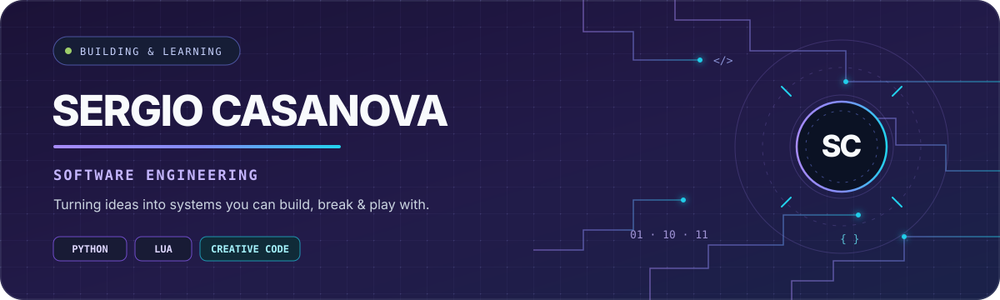
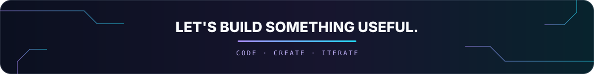

<!--
╭─────────────────────────────────────────────────────────────────────────────╮
│  PROFILE README — SERGIO CASANOVA                                           │
│  Quick setup: open CUSTOMIZE.md and replace every YOUR_... placeholder.      │
│  Header art is editable SVG in assets/sergio-header.svg.                    │
╰─────────────────────────────────────────────────────────────────────────────╯
-->

<div align="center">
  
  <br />
  
  <br />
  <a href="https://github.com/sergiicl"></a>
  <a href="https://www.linkedin.com/in/YOUR_LINKEDIN_USERNAME/"></a>
  
</div>

<br />

## `whoami` 👨‍💻

Hey! I'm **Sergio**, a Computer Science student at the **Complutense University of Madrid (UCM)**, interested in software engineering, creative technology, and turning messy ideas into things that actually work.

- 🎓 Studying Computer Science at UCM.
- 🧠 Into problem-solving, software design, and learning how systems work under the hood.
- 🎛️ Building a **live-coding music system** that explores code-driven sequencing and VST instruments.
- 🎮 Working on **web game development** and interactive experiences.
- 🌱 Currently focused on getting better through projects, experimentation, and feedback.
- 💼 Interested in software engineering internships and opportunities to learn from strong engineering teams.

> `const mindset = "stay curious; ship small; keep improving;"`

## `toolbox` 🧰

<p align="center">
  
</p>

<p align="center">
  <sub>Tools and technologies I've worked with across coursework and projects. This list is meant to evolve as I learn.</sub>
</p>

<div align="center">
  
  
  
  
</div>

## `projects` 🚀

<table>
  <tr>
    <td width="50%" valign="top">
      <h3>🎛️ Live Coding Music System</h3>
      <p>A work-in-progress system for creating and performing music through code, exploring MIDI sequencing and VST instrument support inside a DAW workflow.</p>
      <p><strong>Focus:</strong> Lua · Python · REAPER · MIDI · real-time sequencing</p>
      <a href="https://github.com/YOUR_GITHUB_USERNAME/YOUR_MUSIC_PROJECT_REPO"></a>
    </td>
    <td width="50%" valign="top">
      <h3>🧙 Don't Kill My Date!</h3>
      <p>A fantasy-themed web game about a witch, relationship advice, and potion-making, with game progression and reputation mechanics.</p>
      <p><strong>Focus:</strong> JavaScript · Phaser · game logic · interactive UI</p>
      <a href="https://github.com/YOUR_GITHUB_USERNAME/YOUR_GAME_PROJECT_REPO"></a>
    </td>
  </tr>
</table>

<sub>Project buttons are placeholders until you replace them with the actual repository URLs. Keep university/team work private or link it only when you're allowed to share it.</sub>

## `github_stats()` 📈

<div align="center">
  
  
</div>

<div align="center">
  
</div>

<div align="center">
  
</div>

<!-- OPTIONAL: enable the workflow in .github/workflows/snake.yml and follow CUSTOMIZE.md to add the snake animation. -->
<!-- <div align="center"></div> -->

## `currently` 🧪

```text
learning    → writing cleaner, more maintainable software
building    → a code-first workflow for live music
exploring   → interactive systems and creative tools
improving   → one project, bug, and lesson at a time
```

## `ping` 🤝

Got an interesting project, a neat engineering problem, or an idea that mixes software with creativity? Let's connect.

<div align="center">
  <a href="https://github.com/sergiicl"></a>
  <a href="https://www.linkedin.com/in/sergiicl/"></a>
</div>

<br />

<div align="center">
  
  <br />
  <sub>Designed with curiosity and a suspicious number of angle brackets.</sub>
</div>
